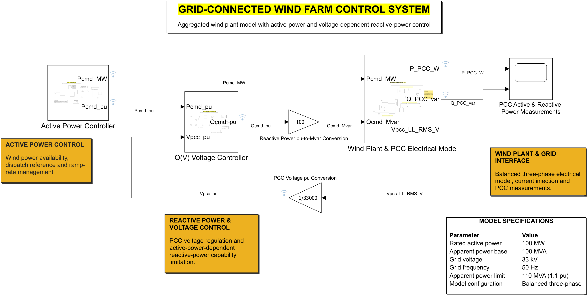
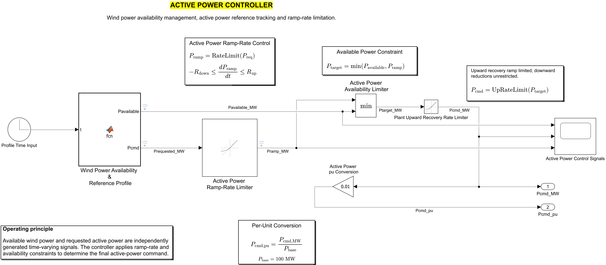
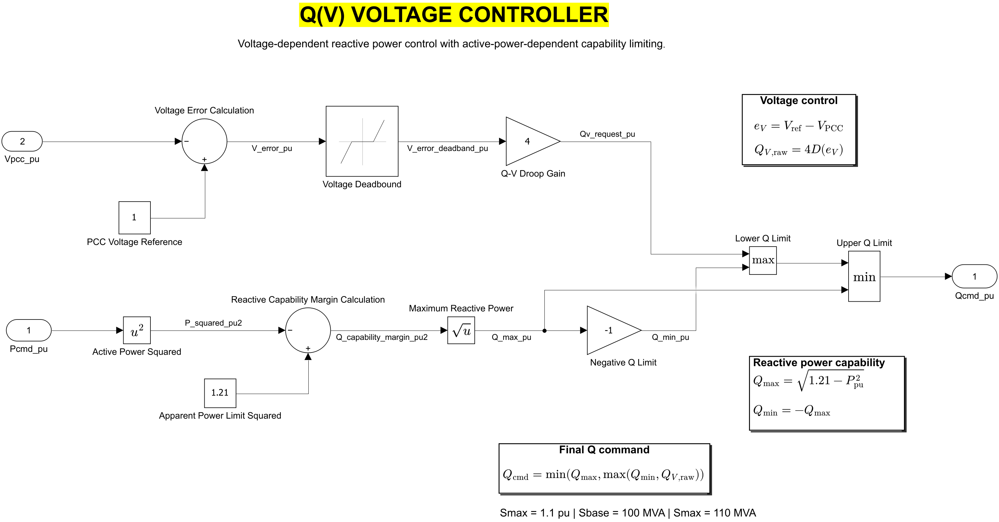
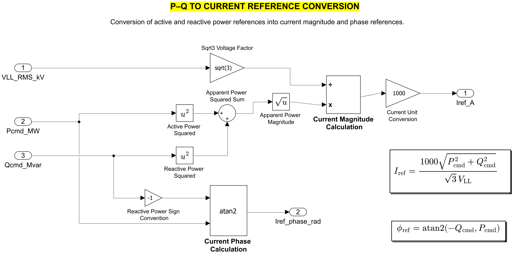
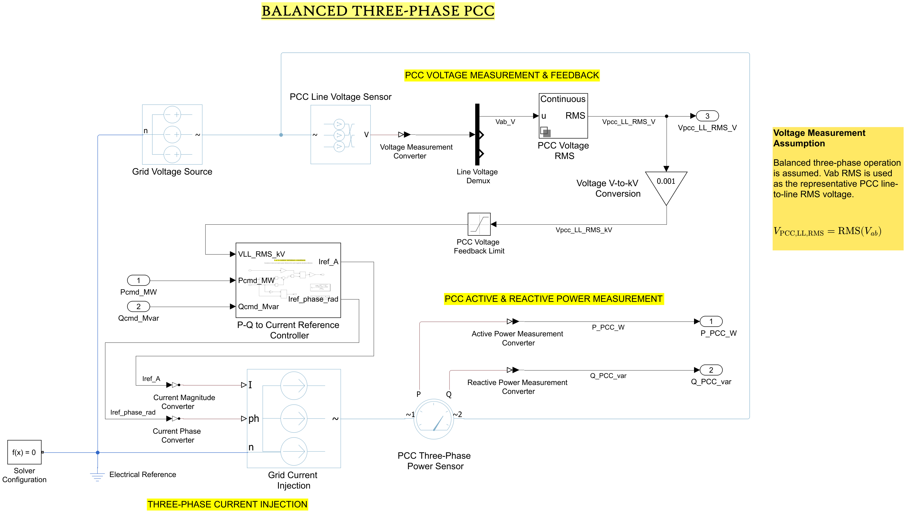

# Grid-Connected Wind Farm Plant Controller

**MATLAB / Simulink · 100 MW Aggregated Wind Farm · Active-Power Curtailment · Q(V) Control · PCC Verification**

A plant-level power controller for a **100 MW aggregated wind farm**, developed in MATLAB/Simulink to study how wind availability, grid-dispatch instructions, active-power ramp limits, and voltage-dependent reactive-power control affect power delivered at the point of common coupling (PCC).

The model combines a dispatch controller, an independent upward-recovery limiter, a Q(V) controller with apparent-power capability limiting, and a simplified balanced three-phase electrical grid.

A **60-minute simulation** evaluates normal operation, curtailment, availability-limited production, sudden generation loss, and controlled recovery.

> **Project scope:** This engineering simulation uses illustrative wind-availability and dispatch profiles. It is not a reconstruction of a historical redispatch event or measured wind-farm SCADA operation. The model uses a simplified 33 kV equivalent grid connection without an explicit 33/110 kV transformer or individual turbines.

---

## At a Glance

| Parameter | Value |
|---|---|
| Rated wind-farm active power | 100 MW |
| Power base | 100 MVA |
| Maximum apparent-power capability | 110 MVA (1.1 pu) |
| Nominal PCC voltage | 33 kV AC |
| Grid frequency | 50 Hz |
| Grid short-circuit power | 3,000 MVA |
| Short-circuit ratio (SCR) | 30 |
| Grid X/R ratio | 10 |
| Normal dispatch ramp limits | ±10 MW/min |
| Plant upward-recovery limit | +10 MW/min |
| Simulation duration | 3,600 seconds (60 minutes) |
| Results logging interval | 1 second |
| Solver | ode15s (variable-step) |

### Key Simulation Results

| Performance metric | Result |
|---|---|
| PCC active-power tracking RMSE | **0.0508 MW** |
| PCC active-power tracking MAE | **0.0402 MW** |
| Maximum absolute tracking error | **0.2123 MW** |
| Maximum commanded upward ramp | **+10 MW/min** |
| Upward ramp violations | **0** |
| Maximum availability exceedance | **0 MW** |
| Total modelled energy not produced | **10.923 MWh** |
| PCC voltage range | **0.9991–1.0051 pu** |

---

## 1. System Architecture

### 1.1 Top-Level Simulink Model



The model consists of three main subsystems:

1. **Active Power Controller** — manages wind availability, grid dispatch instructions, ramp-rate constraints and active-power commands.
2. **Q(V) Voltage Controller** — generates voltage-dependent reactive-power references and applies apparent-power capability limitations.
3. **Wind Plant & PCC Electrical Model** — represents the aggregated wind farm, grid connection, controlled current injection and PCC measurements.

The active-power and reactive-power controllers generate references that are converted into three-phase current commands. PCC voltage measurements provide feedback to the reactive-power controller.

### 1.2 Active Power Controller



The Active Power Controller manages the relationship between available wind generation, requested dispatch power and the final plant output command.

Three primary constraints are implemented:

**Dispatch Rate Limiter**

The requested power reference is subject to symmetric ramp limits:

$$
-10 \leq \frac{dP_{\mathrm{ramp}}}{dt} \leq 10
\quad \mathrm{MW/min}
$$

**Wind Availability Constraint**

The plant cannot command more power than the available wind generation:

$$
P_{\mathrm{target}} =
\min(P_{\mathrm{available}}, P_{\mathrm{ramp}})
$$

**Plant Upward Recovery Rate Limiter**

A second Rate Limiter prevents sudden increases in commanded power when wind availability recovers.

$$
P_{\mathrm{cmd}} =
\operatorname{UpRateLimit}(P_{\mathrm{target}})
$$

The final controller allows:

- Gradual increases and decreases following normal grid-dispatch requests.
- Rapid downward reductions when wind generation becomes unavailable.
- Controlled upward recovery when previously unavailable generation returns.
- Enforcement of wind availability and dispatch constraints.

The final commanded active power is converted to per unit using a 100 MW base.

### 1.3 Q(V) Voltage Controller



The Q(V) controller provides voltage-dependent reactive-power control using PCC voltage feedback.

The voltage error is defined as:

$$
e_V = V_{\mathrm{ref}} - V_{\mathrm{PCC}}
$$

The controller uses:

- Nominal voltage reference: **1.0 pu**
- Voltage deadband: **±0.01 pu**
- Q(V) droop gain: **4 pu/pu**
- Maximum apparent-power capability: **1.1 pu**

The reactive-power reference is obtained from the voltage deviation and deadband function:

$$
Q_{V,\mathrm{raw}}=K_{QV}D(e_V)
$$

The available reactive-power capability depends on the active-power command:

$$
Q_{\max} =
\sqrt{1.1^2-P_{\mathrm{cmd,pu}}^2}
$$

$$
Q_{\min}=-Q_{\max}
$$

The final reactive-power command is:

$$
Q_{\mathrm{cmd}} =
\min\left(
Q_{\max},
\max(Q_{\min},Q_{V,\mathrm{raw}})
\right)
$$

This ensures the commanded operating point remains within the assumed apparent-power capability envelope.

The capability calculation uses commanded rather than measured active power.

### 1.4 P–Q to Current Reference Controller



The P–Q to Current Reference Controller converts active and reactive power commands into current magnitude and phase references for the three-phase electrical model.

The current magnitude is calculated as:

$$
I_{\mathrm{ref}} =
\frac{
1000\sqrt{P_{\mathrm{cmd}}^2+Q_{\mathrm{cmd}}^2}
}{
\sqrt{3}V_{LL}
}
$$

The current phase is calculated as:

$$
\phi_{\mathrm{ref}} =
\operatorname{atan2}(-Q_{\mathrm{cmd}},P_{\mathrm{cmd}})
$$

Where:

- \(P_{\mathrm{cmd}}\): Active-power command (MW)
- \(Q_{\mathrm{cmd}}\): Reactive-power command (Mvar)
- \(V_{LL}\): Line-to-line RMS voltage (kV)
- \(I_{\mathrm{ref}}\): Current magnitude (A)
- \(\phi_{\mathrm{ref}}\): Current phase (rad)

The phase convention follows the model's current-injection implementation.

### 1.5 Wind Plant & PCC Electrical Model



The electrical model represents the aggregated 100 MW wind farm using controlled three-phase current injection into a finite-impedance grid equivalent.

The subsystem includes:

- Three-phase grid voltage source
- Controlled three-phase current injection
- Grid impedance representation
- PCC line-to-line voltage measurement
- Active-power measurement
- Reactive-power measurement
- Current-reference conversion and physical-signal interfaces

The PCC voltage measurement is also used as feedback for Q(V) control.

The model assumes balanced three-phase operation, with one line-to-line RMS voltage serving as the representative PCC voltage.

**Electrical modelling boundary**

The model uses a 33 kV equivalent grid interface. It does not explicitly include individual wind turbines, collector-network cables, turbine converters or a 33/110 kV step-up transformer.

A typical large German onshore wind farm may connect to a 110 kV network through an internal medium-voltage collector system and step-up transformer. These components are outside the scope of the current control-oriented model.

---

## 2. Simulation Scenarios

A 60-minute simulation was constructed to evaluate the controller under multiple operating conditions.

The wind availability profile combines gradual generation variations with one sudden turbine-group outage.

Grid-dispatch requests change independently from available wind power.

| Simulation time | Operating condition | Verification objective |
|---|---|---|
| 0–10 min | Normal operation around 80 MW | Stable PCC power tracking |
| 10–20 min | Dispatch reduction from 80 to 50 MW | Downward ramp-rate control |
| 20–28 min 20 s | Curtailment released toward 80 MW | Upward dispatch ramp |
| 28 min 20 s–45 min | Dispatch raised toward 95 MW | Availability-constrained operation |
| At 36 min 40 s | Approximately 30 MW availability loss | Simulated turbine-group outage |
| Around 40–42 min | Wind availability restoration | Upward recovery-rate control |
| 45–52 min 30 s | Second curtailment to 65 MW | Repeated dispatch response |
| 52 min 30 s–60 min | Dispatch increased toward 90 MW | Final recovery and availability constraint |

The **10 MW/min** ramp-rate limit is an illustrative engineering design parameter, not a claim of a universal German grid-code requirement.

The simulated availability outage represents a rapid loss of generation, rather than a sudden meteorological change in wind conditions.

---

## 3. Simulation Results

### 3.1 Active-Power Control and Curtailment


The first figure compares:

- Available wind power
- Grid-dispatch request
- Ramp-limited dispatch reference
- Final plant power command
- Measured PCC active power

The controller manages dispatch curtailment, wind availability constraints and controlled recovery.

When the grid-dispatch request exceeds available wind generation, the controller restricts the final command to the available power.

### 3.2 PCC Active-Power Tracking


Measured PCC active power closely follows the final commanded active power throughout the simulation.

| Tracking performance | Result |
|---|---|
| Root Mean Square Error (RMSE) | 0.0508 MW |
| Mean Absolute Error (MAE) | 0.0402 MW |
| Maximum absolute error | 0.2123 MW |

The tracking RMSE corresponds to approximately **0.051% of the rated 100 MW plant capacity**.

Small variations in PCC measured power remain visible due to the electrical model and measurement dynamics.

### 3.3 Reactive-Power and Voltage Behaviour


The PCC voltage remains close to nominal throughout the 60-minute simulation.

| Measurement | Observed range |
|---|---|
| PCC voltage | 0.9991–1.0051 pu |
| Reactive-power command | Approximately 0 Mvar |
| Measured PCC reactive power | 0.823–2.797 Mvar |

The Q(V) command remains zero because the voltage stays inside the controller's deadband.

However, measured PCC reactive power is nonzero because of the finite grid impedance and electrical interaction between injected power and the grid.

**A zero Q(V) command does not necessarily imply zero measured reactive power at the PCC.**

Separate short-duration voltage-disturbance tests were performed during development to verify the direction of the Q(V) response under overvoltage and undervoltage.

The final 60-minute nominal-voltage scenario does not independently demonstrate reactive-power capability saturation.

### 3.4 Ramp-Rate Verification


The refined ramp-rate verification includes:

1. Dispatch-reference ramp-rate compliance.
2. Final commanded-power upward ramp-rate compliance.
3. A detailed view of the simulated turbine-group outage and subsequent recovery.

The results show:

| Ramp-rate measurement | Result |
|---|---|
| Maximum dispatch upward ramp | +10 MW/min |
| Maximum dispatch downward ramp | −10 MW/min |
| Maximum final commanded upward ramp | +10 MW/min |
| Upward ramp violations | 0 |
| Maximum final downward change during outage | Approximately −1800 MW/min |

The large downward value occurs during the intentional loss of approximately 30 MW of available generation in one second.

Such a rapid reduction is permitted in the model because the plant cannot continue exporting generation that is no longer available.

In contrast, restoration of generation is subject to the upward recovery-rate limit.

The ramp-rate checks are based on one-second logged data.

### 3.5 Modelled Energy Reduction


Energy not produced is estimated by comparing the available wind-energy profile with the final commanded power.

$$
E_{\mathrm{not\ produced}} =
\frac{1}{3600}
\int_0^{3600}
\max(P_{\mathrm{available}}-P_{\mathrm{cmd}},0)\,dt
$$

| Energy metric | Result |
|---|---|
| Available wind energy | 84.601 MWh |
| Commanded energy | 73.678 MWh |
| Dispatch-constrained energy reduction | 10.641 MWh |
| Additional recovery-ramp energy reduction | 0.282 MWh |
| **Total modelled energy not produced** | **10.923 MWh** |

The dispatch-constrained component includes the initial steady requested-power limit as well as later curtailment instructions.

The additional recovery-ramp component represents energy not produced while the plant gradually increases output following restored wind availability.

The total energy reduction is the sum of both components.

These are results from an illustrative simulation, not measured historical redispatch volumes or financial losses.

---

## 4. Tools and Technologies

The project was developed using:

- **MATLAB/Simulink** — control-system development and simulation
- **Simscape Electrical** — three-phase electrical-network modelling
- **MATLAB scripting** — data extraction, numerical verification and results visualisation
- **GitHub** — source-code management, documentation and reproducibility

The model was developed using the MATLAB R2026b environment.

---

## 5. Repository Structure

```text
wind-farm-plant-controller/
├── model/
│   └── WindPlantActivePowerController_Final.slx
│
├── scripts/
│   ├── verify_windplant_60min.m
│   └── refine_windplant_results.m
│
├── docs/
│   └── images/
│       ├── 01_top_level_model.png
│       ├── 02_active_power_controller.png
│       ├── 03_qv_controller.png
│       ├── 04_pq_to_current_reference.png
│       └── 05_wind_plant_pcc_model.png
│
├── results/
│   ├── data/
│   │   └── WindPlant_60min_Final.mat
│   │
│   └── plots/
│       ├── 01_Active_Power_Control.png
│       ├── 02_PCC_Active_Power_Tracking.png
│       ├── 03_Reactive_Power_and_Voltage.png
│       ├── 04_Ramp_Rate_Verification_Refined.png
│       └── 05_Modelled_Energy_Reduction.png
│
├── README.md
└── LICENSE
```

The repository contains the Simulink model, MATLAB verification scripts, selected figures and simulation data where included.

---

## 6. Reproducing the Results

### Requirements

- MATLAB
- Simulink
- Simscape
- Relevant Simscape Electrical components

### Procedure

1. Open the Simulink model from the `model/` directory.
2. Verify that the active-power scenario and both Rate Limiters are configured for the final 60-minute test.
3. Set the simulation stop time to `3600` seconds.
4. Run the simulation using the configured solver.
5. Use the MATLAB scripts in `scripts/` to load logged results, calculate performance metrics and generate figures.

The final Rate Limiter settings are:

**Dispatch Rate Limiter**

- Rising slew rate: `1/6` MW/s
- Falling slew rate: `-1/6` MW/s

**Plant Upward Recovery Rate Limiter**

- Rising slew rate: `1/6` MW/s
- Falling slew rate: `-inf`

Simulation results are logged at one-second intervals.

The included MAT-file, if available, can be used to reproduce the analysis without running the entire electrical simulation.

The MATLAB analysis scripts may require adjustment of local input/output paths depending on the user's directory structure.

---

## 7. Modelling Assumptions and Limitations

This is a control-oriented aggregated wind-farm simulation rather than a detailed turbine-level model.

**Wind availability and dispatch data**

The input profiles are illustrative engineering scenarios. They are not historical SCADA measurements or actual instructions from a German grid operator.

**Aggregated wind-farm representation**

Individual wind turbines, aerodynamic effects, rotor dynamics, drivetrain behaviour and turbine-level converter controls are not explicitly modelled.

**Grid-connection representation**

The model uses a simplified balanced three-phase 33 kV grid connection.

A 33/110 kV transformer, internal collector-network cables and a separate 110 kV PCC are not explicitly represented.

**Reactive-power capability**

The 110 MVA apparent-power envelope is an assumed controller-level constraint rather than a detailed converter thermal or hardware capability model.

**Voltage control**

The nominal-voltage simulation does not fully evaluate reactive-power capability saturation. Additional voltage-disturbance scenarios would be required for comprehensive Q(V) verification.

**Ramp-rate verification**

Ramp-rate compliance is assessed using the one-second logged signals from the specific 60-minute scenario. This does not establish compliance under every possible disturbance or sub-second operating condition.

**Energy accounting**

Estimated energy reduction is relative to the modelled available-power reference and should not be interpreted as historical curtailed generation.

---

## 8. Future Improvements

Potential project extensions include:

- Integration of publicly available German wind-turbine SCADA measurements.
- Reconstruction of documented grid-operator redispatch scenarios.
- Addition of a 33/110 kV step-up transformer and a high-voltage grid connection.
- Automated grid-voltage disturbance profiles for Q(V) testing.
- Expanded reactive-power capability verification.
- Turbine-level power allocation and more detailed plant dynamics.
- Further assessment of PCC power losses and electrical transients.

---

## 9. Project Status

**Version 1 — Completed**

The aggregated 100 MW wind-farm controller has been implemented and evaluated using a 60-minute illustrative operating scenario.

The simulation demonstrates:

- Active-power dispatch and curtailment
- Wind availability constraints
- Symmetric dispatch ramp-rate control
- Upward recovery-rate limiting
- Rapid response to sudden generation loss
- Reactive-power and voltage-control integration
- PCC active/reactive power measurement
- Energy-reduction estimation and verification

Future work will focus on historical operating data and expanded electrical modelling.

---

## Author

**Usama Azhar**

Independent electrical-engineering portfolio project.

GitHub: https://github.com/usama383/wind-farm-plant-controller

**License:** MIT
